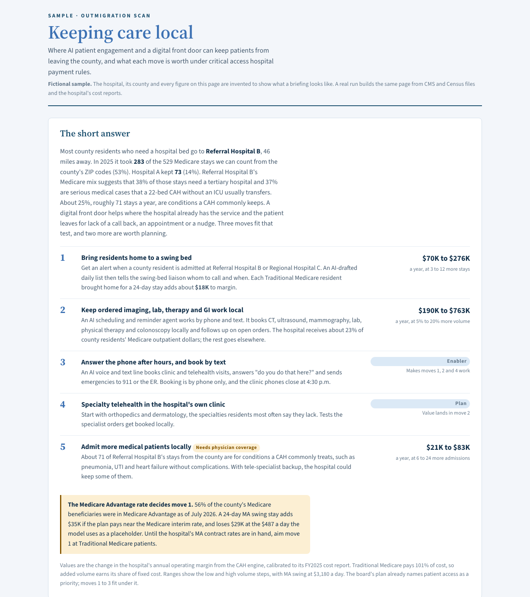
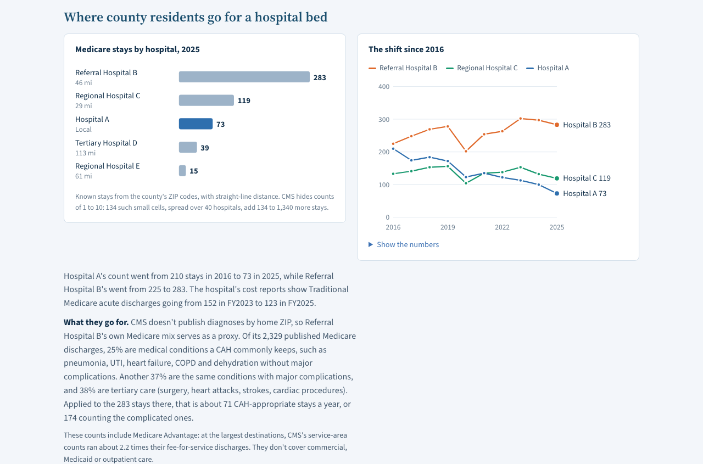
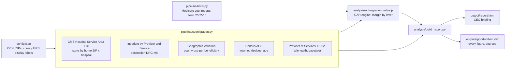
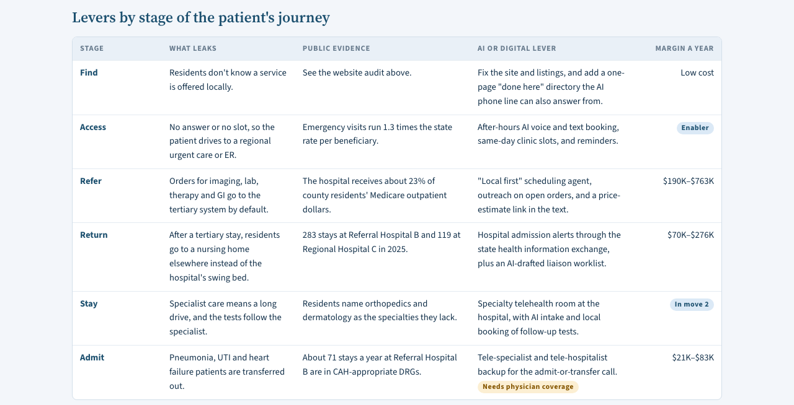
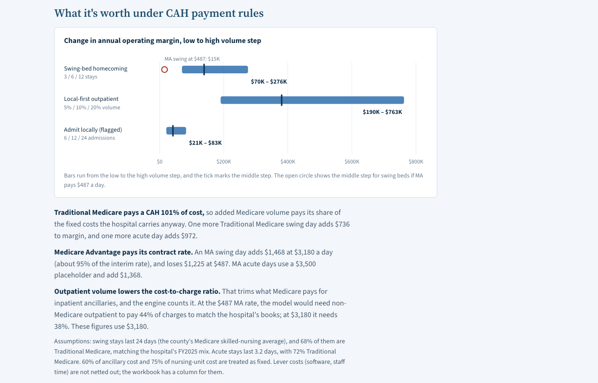

# Rural Hospital Outmigration Scan

**Where can AI patient engagement and a digital front door keep patients in a rural community, and what is each move worth to a critical access hospital?**

This project answers that question for a rural hospital using **public data only**: CMS claims summaries, Medicare cost reports, Census broadband data and the hospital's own website. It values each move under **critical access hospital (CAH) payment rules**, not generic fee-for-service math. The output is a one-page CEO briefing and a workbook that sources every figure.



> **Sample shown:** a fictional 22-bed critical access hospital. The hospital, its county, the hospitals its residents use and every figure are invented to show what a briefing looks like. [`sample/`](sample) generates its inputs and runs them through the real model and report builder.
> **[View the live sample report](https://tyler-scales.github.io/rural-hospital-outmigration-scan/sample-report.html)** for the full interactive page.

## Run it for your hospital with Claude Code

1. Download or clone this repository.
2. Open the folder in [Claude Code](https://claude.com/claude-code).
3. Type `/outmigration-assessment` followed by your hospital's CMS Certification Number (CCN), or its name and state.

Claude Code follows [CLAUDE.md](CLAUDE.md):

- It confirms the hospital and drafts its service area from Census ZIP and county data, then checks the ZIP list with you.
- It downloads the public CMS and Census data and your hospital's Medicare cost reports.
- It runs the CAH value model and builds the briefing page and workbook.
- It writes a tailored data request listing the internal information that would sharpen the assessment, most valuable first.

**No patient data, ever.** The assessment runs on public data plus aggregate counts. Claude Code is instructed never to ask for, open or use protected health information. Hospital counts go in `inputs/`, use the shapes in [`templates/`](templates), show any count from 1 to 10 as `<11`, and never leave your machine. See the [data request](docs/data-request.md) for what to send and how.

Requirements: Python 3.9+ with `openpyxl`, and Node 18+. A run downloads about 500 MB of public files and takes 10 to 20 minutes.

---

## Why it's built this way

A rural hospital CEO asked a simple question: *where can AI keep patients from leaving the county?* Most answers to that question are vendor pitches. This one starts from where patients actually go and what the hospital can actually provide. It then prices each move the way a CAH is really paid:

- **Traditional Medicare pays a CAH 101% of its costs.** Added Medicare volume pays a share of fixed costs the hospital carries anyway, so its value is not "charges times volume."
- **Medicare Advantage pays a contract rate.** In the fictional sample county, 56% of beneficiaries are in Medicare Advantage. At a nursing-home-level MA rate, bringing an MA patient home to a swing bed *loses* about $29K per stay. At a rate near the Medicare interim rate, it *adds* about $35K. The MA contract decides whether the top move pays.
- **More outpatient volume lowers the cost-to-charge ratio.** That trims what Medicare pays for inpatient ancillaries. The engine counts this second-order effect.

## What the sample shows

The sample's figures are invented, but they come out of the same pipeline, model and checks a real run uses.

| | |
|---|---|
| Where residents go | The top referral hospital, 46 miles away, took **283 of 529** countable Medicare stays (53%). The local CAH kept **73** (14%), down from 210 in 2016. |
| Why they go | 38% of those stays need a tertiary hospital, and 37% are serious medical cases a 22-bed CAH without an ICU usually transfers. About **71 stays a year** are conditions a CAH commonly keeps. |
| Outpatient leakage | The hospital's Medicare outpatient settlement equals about **23%** of county residents' fee-for-service outpatient spending, so at least **$6.9M a year** in fee-for-service dollars alone goes elsewhere. |
| Can residents use it? | 16% of county households have no internet (8% statewide). The front door should be **voice and text first**, with a portal second. |

**Ranked moves** (change in annual operating margin):

1. **Bring residents home to a swing bed**: $70K–$276K. Admission alerts from the state health information exchange feed an AI-drafted daily worklist for the swing-bed liaison.
2. **Keep ordered imaging, lab, therapy and GI work local**: $190K–$763K. An AI scheduling and reminder agent works by phone and text and follows up on open orders.
3. **Answer the phone after hours, and book by text**: the enabler for moves 1, 2 and 4.
4. **Specialty telehealth in the hospital's own clinic**: its value lands in move 2, through tests booked locally.
5. **Admit more medical patients locally**: $21K–$83K, flagged because it needs physician coverage.



## How it works



| Step | What it does |
|---|---|
| `pipeline/outmigration.py` | Pulls 11 years of CMS service-area data for the hospital's ZIP codes, plus destination hospitals' DRG mix, county Medicare utilization, the newest monthly Medicare Advantage share, rural health clinics, quarterly telehealth use and Census broadband tables. It streams the Census summary files and filters them on the fly, since the Census API now needs a key. |
| `pipeline/outmigration_geo.py` | For named runs, pulls Census boundary shapes (ZIP areas, counties, states) around the destination hospitals and places each hospital at its ZIP's center, for the interactive map. |
| `pipeline/hcris.py` | Decodes CMS cost-report bulk files for every CAH into the record the engine uses: days by payer, departmental costs and charges, and Medicare settlement worksheets. |
| `engine/engine.js` | A deterministic restatement of the CAH cost report (D-1 per diem, C Pt I ancillaries, E-2/E-3/E Pt B settlements), with costs split into fixed and variable parts so volume and payer mix can move. |
| `analysis/outmigration_value.js` | Values each lever as a change in operating margin at three volume steps and two MA rate cases. |
| `analysis/build_report.py` | Computes every figure once and writes both the briefing page and the workbook. It checks the workbook's formulas against the page and refuses to build if any placeholder or stray value slips through. |

### Checks built in

- The engine reproduces the hospital's filed operating income exactly at baseline.
- A hand calculation for one department (radiology +10%) must match the engine to the cent, including the inpatient cost-to-charge ratio effect.
- CMS suppresses counts of 1–10. Those cells are never summed as zero; they're carried as "small cells" with low/high bounds.
- **A data finding along the way:** the CMS Hospital Service Area File counts include Medicare Advantage stays. They run about 2.3× fee-for-service discharges at the same hospitals. The pipeline checks this on every run, because it changes how the counts should be read.
- With `"anonymize": true`, the page and workbook carry labels only. No CMS numbers, cities or ZIP codes are embedded, even in the page's chart data, and the map is left out because geography alone identifies a county.
- With `"hide_towns": true`, hospitals keep their names but no town appears anywhere. Town words are dropped from hospital names, a name left generic is tagged with its county ("Hospital (Adams County)"), and the build fails if a town slips through.





## The map (named runs)

When a run isn't anonymized, the briefing opens its "where residents go" section with an interactive map:

- one circle per destination, sized by Medicare stays, with a line from the county whose width follows the same count
- a home-ZIP picker (buttons, or a menu when there are many ZIPs) and a year slider with a play button, 2016 to the latest year
- tooltips on circles and ZIPs, including each ZIP's broadband and age figures, and a ranked list that stays in sync with the map
- an optional layer for nearby rural health clinics
- hidden counts (1 to 10) drawn as open circles and dotted lines, never as zeros

The shapes come from Census generalized boundaries and are projected at build time, so the page needs no map tiles or outside requests.

Test runs on real critical access hospitals exercised the generic paths: larger service areas, outpatient surgery, and CT and MRI billed as separate cost centers. Config `op_lines` sets which departments the outpatient lever scales, and `op_move_title` renames that move.

## Repository layout

```
CLAUDE.md              the assessment workflow and no-PHI rules Claude Code follows
.claude/commands/      the /outmigration-assessment command
pipeline/
  service_area.py      drafts config.json: the hospital's county and service-area ZIP codes
  outmigration.py      public-data pull (CMS + Census) for one hospital
  outmigration_geo.py  boundary shapes and hospital locations for the map
  hcris.py             CMS cost-report download and decoder for critical access hospitals
engine/
  engine.js            CAH cost-based reimbursement engine (browser + Node)
analysis/
  outmigration_value.js  margin value of each lever under CAH rules
  build_report.py        figures -> briefing page + sourced workbook
  report.template.html   the briefing page
sample/
  make_sample_data.js  invents the fictional sample hospital's inputs
  sample-config.json   the sample's config
docs/
  data-request.md      what to ask the hospital for, as aggregate counts only
  sample-report.html   the fictional sample's briefing (published with GitHub Pages)
  index.html           redirects the Pages site to the sample report
  screenshots/         images used above
templates/             CSV shapes for the hospital's aggregate counts
config.example.json    the inputs a run needs
```

## Running it by hand

The same steps Claude Code runs:

```bash
python3 -I pipeline/service_area.py <ccn>                # drafts config.json; review the ZIP list
python3 -I pipeline/outmigration.py config.json
python3 -I pipeline/outmigration_geo.py config.json      # map shapes; skipped for anonymized runs
python3 -I pipeline/hcris.py run <ccn>                   # downloads and decodes the CMS cost reports
node analysis/outmigration_value.js config.json
python3 analysis/build_report.py config.json
```

`config.json`, `data/`, `output/`, `inputs/` and `pipeline/cache/` are git-ignored, so the hospital being studied never lands in the repository.

## Data sources

All public: Census 2020 ZCTA-to-county relationship file; CMS Hospital Service Area File (CY2015–2025); Medicare Inpatient Hospitals by Provider, and by Provider and Service; Medicare Geographic Variation by county; Medicare Monthly Enrollment (newest Medicare Advantage share); Provider of Services; Rural Health Clinic Enrollments; Medicare Telehealth Trends; HCRIS cost reports (Form 2552-10); Census ACS 5-year 2020–2024 (tables B28001, B28002, B28005); Census 2024 ZCTA Gazetteer; Census TIGERweb generalized boundaries (2020 ZCTAs, counties, states).

## Limitations

- **Diagnoses:** CMS publishes none by home ZIP, so the destination hospital's own Medicare mix stands in for residents' stays there.
- **Payers:** service-area counts cover Medicare only (fee-for-service and MA). Commercial, Medicaid and outpatient destinations need the hospital's own referral and claims exports.
- **Rates and volumes:** MA contract rates are placeholders until the hospital's contracts are loaded. Volume steps for each lever are assumptions, shown as ranges.
- **Costs:** lever costs (software, staff time) are left for the user to enter; the workbook nets them out.

---

Built by Tyler Wallace at ScaleStreet, with Claude Code.

**© 2026 Tyler Wallace.** Hospitals and health systems may run and modify this tool to assess their own outmigration, for internal use. Reselling it, redistributing it or offering it as a service to others needs written permission. See [LICENSE](LICENSE).
