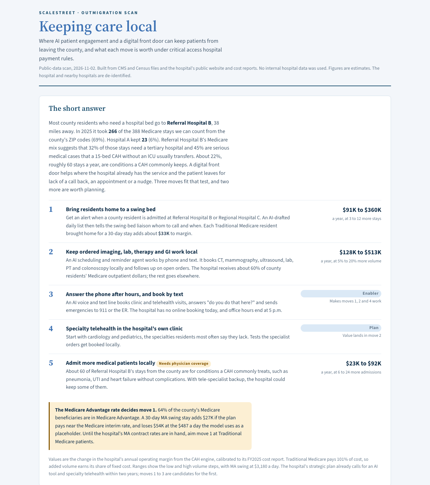
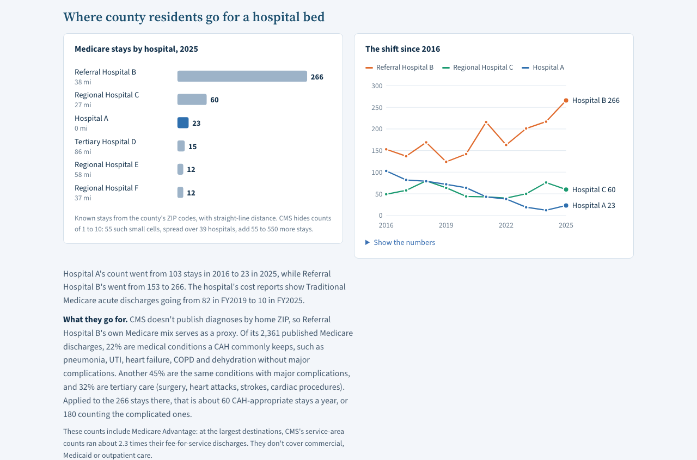
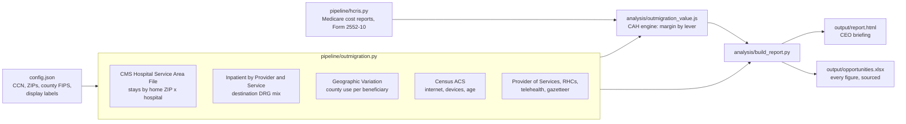
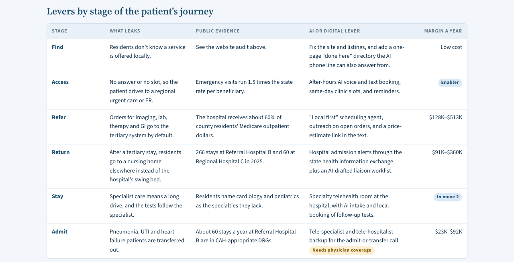
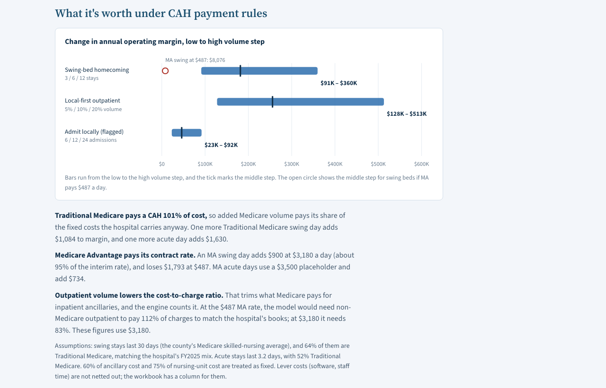

# Rural Hospital Outmigration Scan

**Where can AI patient engagement and a digital front door keep patients in a rural community, and what is each move worth to a critical access hospital?**

This project answers that question for a rural hospital using **public data only**: CMS claims summaries, Medicare cost reports, Census broadband data and the hospital's own website. It values each move under **critical access hospital (CAH) payment rules**, not generic fee-for-service math. The output is a one-page CEO briefing and a workbook that sources every figure.



> **Sample shown:** a 15-bed critical access hospital, de-identified. The hospital is "Hospital A" and the hospitals its residents travel to are lettered. Figures come from real public data for CY2025 and the FY2025 cost report.
> Open [`docs/sample-report.html`](docs/sample-report.html) in a browser for the full interactive page.

---

## Why it's built this way

A rural hospital CEO asked a simple question: *where can AI keep patients from leaving the county?* Most answers to that question are vendor pitches. This one starts from where patients actually go and what the hospital can actually provide. It then prices each move the way a CAH is really paid:

- **Traditional Medicare pays a CAH 101% of its costs.** Added Medicare volume pays a share of fixed costs the hospital carries anyway, so its value is not "charges times volume."
- **Medicare Advantage pays a contract rate.** In the sample county, 64% of beneficiaries are in Medicare Advantage. At a nursing-home-level MA rate, bringing an MA patient home to a swing bed *loses* about $54K per stay. At a rate near the Medicare interim rate, it *adds* about $27K. The MA contract decides whether the top move pays.
- **More outpatient volume lowers the cost-to-charge ratio.** That trims what Medicare pays for inpatient ancillaries. The engine counts this second-order effect.

## What the sample found

| | |
|---|---|
| Where residents go | The top referral hospital, 38 miles away, took **266 of 388** countable Medicare stays (69%). The local CAH kept **23** (6%), down from 103 in 2016. |
| Why they go | About a third of those stays need a tertiary hospital, and 45% are serious medical cases a 15-bed CAH without an ICU usually transfers. About **60 stays a year** are conditions a CAH commonly keeps. |
| Outpatient leakage | The hospital's Medicare outpatient settlement equals about **60%** of county residents' fee-for-service outpatient spending, so at least **$646K a year** in fee-for-service dollars alone goes elsewhere. |
| Can residents use it? | 21% of county households have no internet (7% statewide). The front door should be **voice and text first**, with a portal second. |

**Ranked moves** (change in annual operating margin):

1. **Bring residents home to a swing bed**: $91K–$360K. Admission alerts from the state health information exchange feed an AI-drafted daily worklist for the swing-bed liaison.
2. **Keep ordered imaging, lab, therapy and GI work local**: $128K–$513K. An AI scheduling and reminder agent works by phone and text and follows up on open orders.
3. **Answer the phone after hours, and book by text**: the enabler for moves 1, 2 and 4.
4. **Specialty telehealth in the hospital's own clinic**: its value lands in move 2, through tests booked locally.
5. **Admit more medical patients locally**: $23K–$92K, flagged because it needs physician coverage.



## How it works



| Step | What it does |
|---|---|
| `pipeline/outmigration.py` | Pulls 11 years of CMS service-area data for the hospital's ZIP codes, plus destination hospitals' DRG mix, county Medicare utilization, rural health clinics, telehealth use and Census broadband tables. It streams the Census summary files and filters them on the fly, since the Census API now needs a key. |
| `pipeline/hcris.py` | Decodes CMS cost-report bulk files for every CAH into the record the engine uses: days by payer, departmental costs and charges, and Medicare settlement worksheets. |
| `engine/engine.js` | A deterministic restatement of the CAH cost report (D-1 per diem, C Pt I ancillaries, E-2/E-3/E Pt B settlements), with costs split into fixed and variable parts so volume and payer mix can move. |
| `analysis/outmigration_value.js` | Values each lever as a change in operating margin at three volume steps and two MA rate cases. |
| `analysis/build_report.py` | Computes every figure once and writes both the briefing page and the workbook. It checks the workbook's formulas against the page and refuses to build if any placeholder or stray value slips through. |

### Checks built in

- The engine reproduces the hospital's filed operating income exactly at baseline.
- A hand calculation for one department (radiology +10%) must match the engine to the cent, including the inpatient cost-to-charge ratio effect.
- CMS suppresses counts of 1–10. Those cells are never summed as zero; they're carried as "small cells" with low/high bounds.
- **A data finding along the way:** the CMS Hospital Service Area File counts include Medicare Advantage stays. They run about 2.3× fee-for-service discharges at the same hospitals. The pipeline checks this on every run, because it changes how the counts should be read.
- With `"anonymize": true`, the page and workbook carry labels only. No CMS numbers, cities or ZIP codes are embedded, even in the page's chart data.





## Repository layout

```
pipeline/
  outmigration.py      public-data pull (CMS + Census) for one hospital
  hcris.py             CMS cost-report decoder for every critical access hospital
engine/
  engine.js            CAH cost-based reimbursement engine (browser + Node)
analysis/
  outmigration_value.js  margin value of each lever under CAH rules
  build_report.py        figures -> briefing page + sourced workbook
  report.template.html   the briefing page
docs/
  sample-report.html   de-identified sample output
  screenshots/         images used above
config.example.json    the inputs a run needs
```

## Running it

Requirements: Python 3.9+ with `openpyxl`, and Node 18+.

```bash
cp config.example.json config.json      # set the hospital's CCN, ZIP codes and county FIPS
python3 -I pipeline/outmigration.py config.json
python3 -I pipeline/hcris.py extract cache/hcris/HOSP10FY2024.zip 2024   # CMS cost-report bulk file
python3 -I pipeline/hcris.py survey 2024
python3 -I pipeline/hcris.py hospital <ccn>
node analysis/outmigration_value.js config.json
python3 analysis/build_report.py config.json
```

`config.json`, `data/` and `output/` are git-ignored, so the hospital being studied never lands in the repository.

## Data sources

All public: CMS Hospital Service Area File (CY2015–2025); Medicare Inpatient Hospitals by Provider, and by Provider and Service; Medicare Geographic Variation by county; Provider of Services; Rural Health Clinic Enrollments; Medicare Telehealth Trends; HCRIS cost reports (Form 2552-10); Census ACS 5-year 2020–2024 (tables B28001, B28002, B28005); Census 2024 ZCTA Gazetteer.

## Limitations

- **Diagnoses:** CMS publishes none by home ZIP, so the destination hospital's own Medicare mix stands in for residents' stays there.
- **Payers:** service-area counts cover Medicare only (fee-for-service and MA). Commercial, Medicaid and outpatient destinations need the hospital's own referral and claims exports.
- **Rates and volumes:** MA contract rates are placeholders until the hospital's contracts are loaded. Volume steps for each lever are assumptions, shown as ranges.
- **Costs:** lever costs (software, staff time) are left for the user to enter; the workbook nets them out.

---

Built by Tyler Wallace at ScaleStreet, with Claude Code.

**© 2026 Tyler Wallace. All rights reserved.** Shared for portfolio viewing only; see [LICENSE](LICENSE). No permission is granted to use, copy or modify this code.
